# StockGrid — Complete System Architecture

> Version 1.1 | Updated 2026-07-31

---

## Table of Contents
1. [System Overview](#1-system-overview)
2. [Frontend Architecture](#2-frontend-architecture)
3. [Backend Architecture](#3-backend-architecture)
4. [Database Architecture](#4-database-architecture)
5. [Authentication Architecture](#5-authentication-architecture)
6. [File Storage Architecture](#6-file-storage-architecture)
7. [Notification Architecture](#7-notification-architecture)
8. [AI / Forecast Architecture](#8-ai--forecast-architecture)
9. [Reporting Architecture](#9-reporting-architecture)
10. [API Gateway Design](#10-api-gateway-design)
11. [Caching Strategy](#11-caching-strategy)
12. [Queue System](#12-queue-system)
13. [Logging & Monitoring](#13-logging--monitoring)
14. [Backup Strategy](#14-backup-strategy)

---

## 1. System Overview

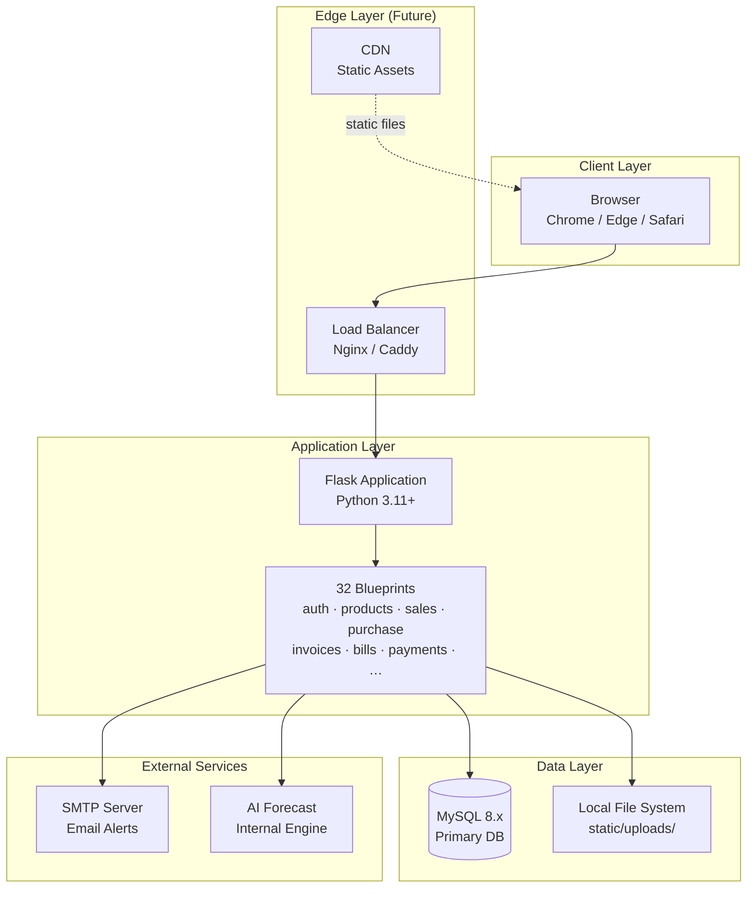

---

## 2. Frontend Architecture

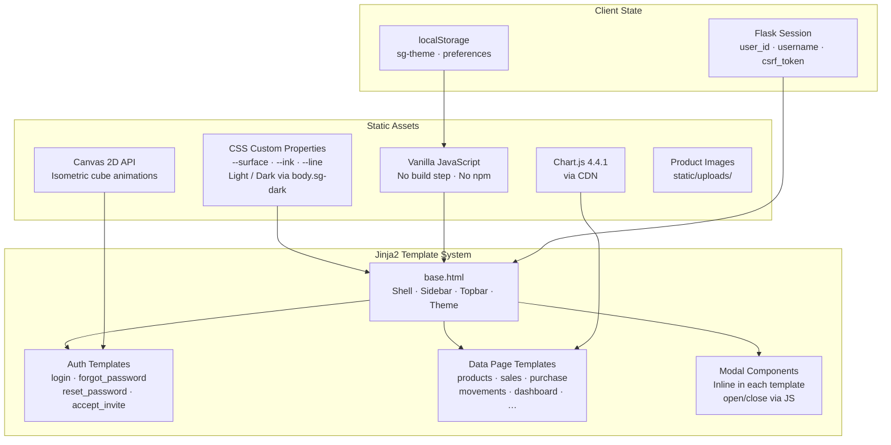

### Key Frontend Patterns

| Pattern | Implementation |
|---------|---------------|
| Dark Mode | `body.sg-dark` CSS class, toggled via JS, persisted to `localStorage` |
| CSRF | Token injected into all POST forms via `base.html` auto-fill script |
| Loading Screen | Intercepts `<a>` navigation, shows animated cube overlay |
| Responsive | CSS Grid + Flexbox, sidebar collapses on mobile |
| Charts | Chart.js with gradient fills, 30/60/90-day trend windows |

---

## 3. Backend Architecture

```mermaid
graph TB
    subgraph Request["Request Pipeline"]
        REQ[HTTP Request]
        ENSURE_CSRF[before_request:<br/>_ensure_csrf]
        CHECK_CSRF[before_request:<br/>_check_csrf]
        LOGIN_REQUIRED[Decorator:<br/>@login_required]
        ROUTE[Blueprint Route Handler]
        SEC_HEADERS[after_request:<br/>_security_headers]
        RESP[HTTP Response]
    end

    subgraph Blueprints["Registered Blueprints (21)"]
        AUTH[auth · auth_ext]
        CORE[products · categories<br/>suppliers · movements<br/>adjustments · locations]
        ORDERS[purchase · sales]
        ANALYTICS[dashboard · reports<br/>forecast · search]
        SETTINGS[settingshub · org<br/>currencies · payment_terms<br/>users · roles · pages]
        AUTO[reorder_rules]
    end

    subgraph Shared["Shared Utilities"]
        DB[db.py<br/>MySQL Connection Pool<br/>pool_size=32]
        HELPERS[helpers.py<br/>log_history · stock_status<br/>get_thresholds]
        AUDIT[audit_utils.py<br/>audit() → audit_logs table]
        EMAIL[email_utils.py<br/>send_email · maybe_send_alert]
        PDF[pdf_utils.py<br/>fpdf2 · branded PDFs]
        REORDER[reorder_rules.py<br/>check_and_fire]
    end

    REQ --> ENSURE_CSRF --> CHECK_CSRF --> LOGIN_REQUIRED --> ROUTE
    ROUTE --> SEC_HEADERS --> RESP
    ROUTE --> AUTH
    ROUTE --> CORE
    ROUTE --> ORDERS
    ROUTE --> ANALYTICS
    ROUTE --> SETTINGS
    ROUTE --> AUTO
    AUTH & CORE & ORDERS & ANALYTICS & SETTINGS & AUTO --> DB
    CORE & ORDERS --> AUDIT
    CORE & ORDERS --> EMAIL
    ORDERS --> PDF
    CORE --> REORDER
```

### Blueprint Responsibility Map

| Blueprint | Endpoints | Key Features |
|-----------|-----------|-------------|
| `auth` | `/login` `/logout` `/register` | Session management, lockout integration |
| `auth_ext` | `/forgot-password` `/reset-password` `/invite` `/accept-invite` `/verify-email` | Token-based flows, account lockout, invitations |
| `products` | `/products` `/products/add` `/products/<id>` | Soft-delete, barcode, cost_price, CSV import/export |
| `purchase` | `/purchase-orders` `/receive` | Partial receipts per line, auto cost from unit_cost |
| `sales` | `/sales` `/confirm` `/ship` `/cancel` | Stock reservations, reorder triggers on ship |
| `reorder_rules` | `/reorder-rules` | CRUD + `check_and_fire()` public helper |
| `dashboard` | `/` | 6 KPI cards, 5 Chart.js charts, retrospective value trend |
| `reports` | `/reports` | CSV exports, summary tables |
| `forecast` | `/forecast` | AI demand forecast, EOQ, lead-time awareness |

---

## 4. Database Architecture

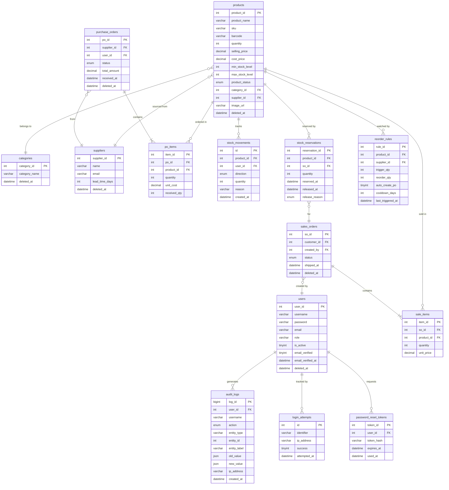

### Key Data Patterns

| Pattern | Implementation |
|---------|---------------|
| Soft Delete | `deleted_at DATETIME NULL` on products, categories, suppliers, customers, orders, users |
| Audit Trail | Dual: `product_history` (stock changes) + `audit_logs` (all entity changes) |
| Stock Reservations | Created on SO CONFIRM, released on SHIP or CANCEL |
| Partial PO Receipts | `po_items.received_qty` tracks per-line receipts; status = PARTIAL or RECEIVED |
| Token Security | Raw token in URL, SHA-256 hash stored in DB — token never touches DB |

---

## 5. Authentication Architecture

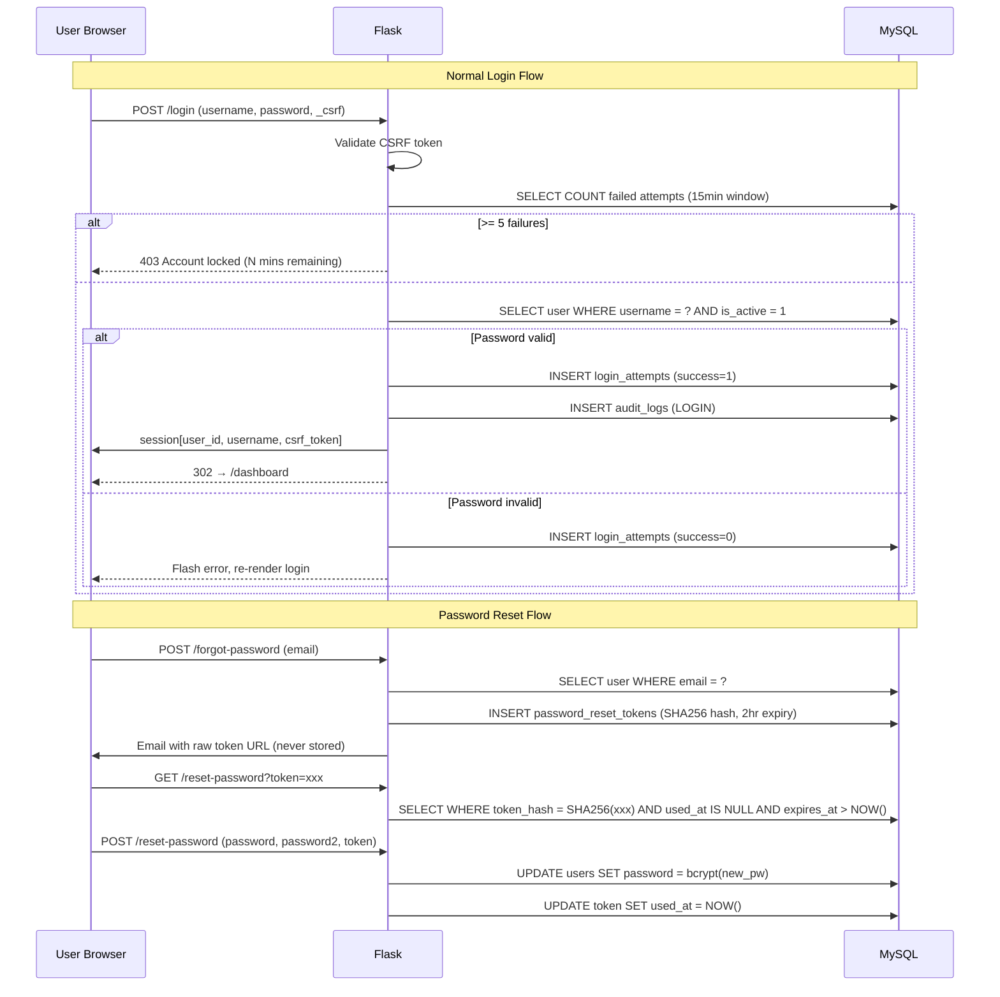

### Security Controls

| Control | Implementation |
|---------|---------------|
| Password Hashing | Werkzeug `generate_password_hash` (bcrypt/pbkdf2) |
| Account Lockout | 5 failures in 15-min window → 30-min lockout |
| CSRF Protection | `secrets.token_hex(32)` per session, `compare_digest` validation |
| Token Security | `secrets.token_urlsafe(48)` raw, SHA-256 hash stored — token never in DB |
| Security Headers | `X-Content-Type-Options`, `X-Frame-Options`, `X-XSS-Protection`, `Referrer-Policy`, `Permissions-Policy` |
| Session | Flask signed cookie, `secret_key` from env var |
| Soft Delete | Users set `deleted_at` — no permanent data destruction |

---

## 6. File Storage Architecture

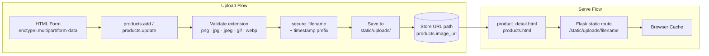

### Current Limitations & V2 Plan

| Concern | Current State | V2 Plan |
|---------|--------------|---------|
| Storage | Local `static/uploads/` | Object Storage (S3 / Cloudflare R2) |
| CDN | None | Serve images via CDN edge |
| Max file size | Flask default 16MB | Enforce 5MB limit + image compression |
| Multi-tenant | Single directory | Org-scoped subdirectories |

---

## 7. Notification Architecture

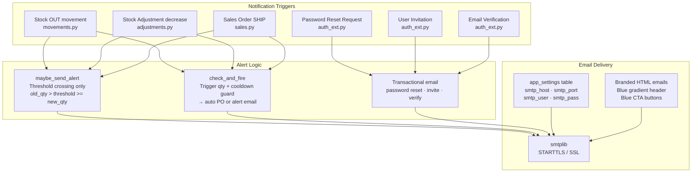

### Email Types

| Type | Trigger | Template |
|------|---------|----------|
| Low Stock Alert | Downward threshold crossing | `_low_stock_html()` in email_utils.py |
| Reorder Alert | `check_and_fire()` without auto PO | `_send_reorder_alert()` in reorder_rules.py |
| Password Reset | `/forgot-password` POST | `_send_reset_email()` in auth_ext.py |
| Email Verification | User registration | `send_verification_email()` in auth_ext.py |
| Invitation | Admin invites user | `invite_user()` in auth_ext.py |

---

## 8. AI / Forecast Architecture

```mermaid
graph TB
    subgraph Input["Data Inputs"]
        HIST[stock_movements<br/>90-day IN/OUT history]
        CURR[products.quantity<br/>Current stock]
        LEAD[suppliers.lead_time_days<br/>Replenishment time]
        META[products.min_stock_level<br/>Safety stock]
    end

    subgraph Engine["Forecast Engine (forecast.py)"]
        DAILY[Compute daily OUT rate<br/>= total_out / days_with_data]
        DFS[Days-to-stockout<br/>= current_qty / daily_rate]
        REORDER_PT[Reorder Point<br/>= daily_rate × lead_time + safety_stock]
        EOQ[EOQ calculation<br/>= sqrt(2 × demand × ordering_cost / holding_cost)]
        PRIORITY[Risk Priority<br/>critical · warning · healthy]
    end

    subgraph Output["Forecast Outputs"]
        TABLE[Forecast Table<br/>per-product risk + ETA]
        ALERTS[Urgent Alerts<br/>DTS < lead_time]
        RECS[Reorder Recommendations<br/>EOQ + suggested PO]
    end

    HIST & CURR & LEAD & META --> DAILY
    DAILY --> DFS & REORDER_PT & EOQ
    DFS & REORDER_PT & EOQ --> PRIORITY
    PRIORITY --> TABLE & ALERTS & RECS
```

### V2 AI Roadmap

| Feature | Technology | Phase |
|---------|-----------|-------|
| Demand forecasting | ARIMA / Prophet | V2 |
| Anomaly detection | Isolation Forest | V2 |
| Smart replenishment | Reinforcement learning | V3 |
| Natural language queries | Claude API (claude-sonnet-4-6) | V3 |
| Computer vision SKU scan | Claude Vision API | V3 |

---

## 9. Reporting Architecture

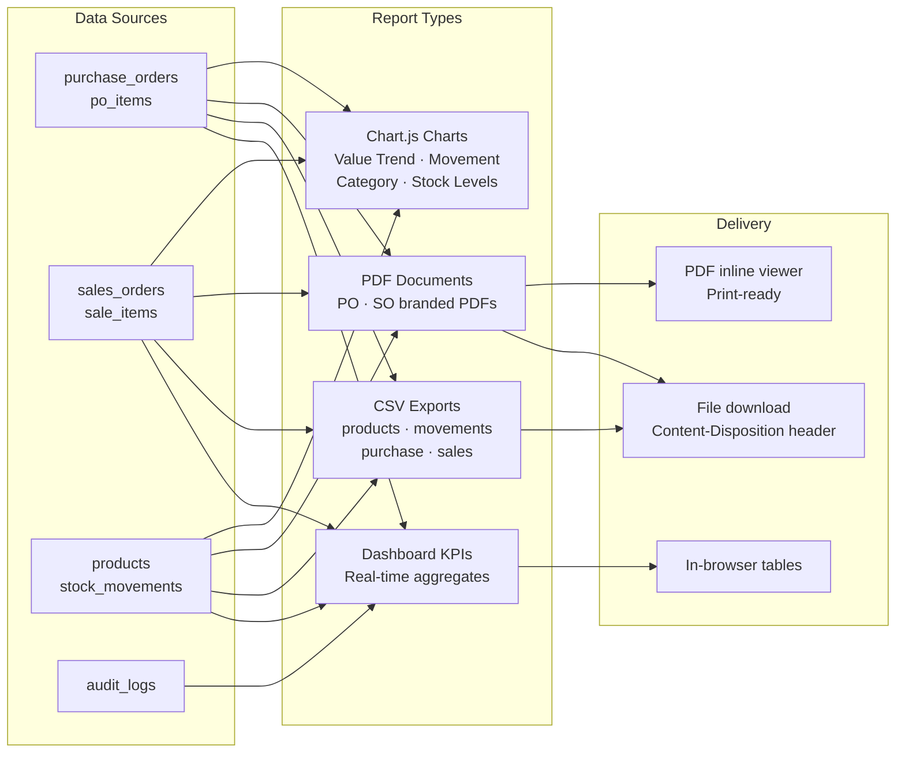

### PDF Generation (fpdf2)

```
_SGDoc(FPDF)
├── header()  — Blue gradient bar + org name + logo area
├── footer()  — Page N of M + generated timestamp
├── make_purchase_order_pdf(po, items, total, currency_symbol, org_name)
└── make_sales_order_pdf(so, items, total, currency_symbol, org_name)
```

---

## 10. API Gateway Design

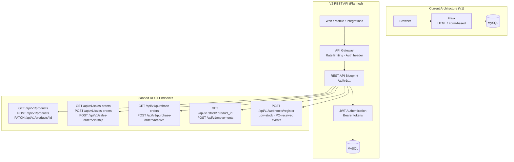

---

## 11. Caching Strategy

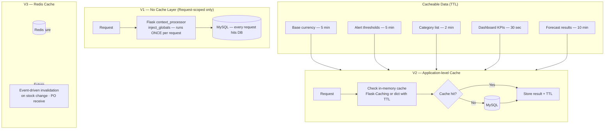

---

## 12. Queue System

```mermaid
graph TB
    subgraph Current["V1 — Synchronous (In-request)"]
        ROUTE[Route Handler]
        EMAIL_SYNC[send_email — blocks request<br/>~2s on slow SMTP]
        PDF_SYNC[make_*_pdf — blocks request<br/>~100ms]
        AUDIT_SYNC[audit() — always async-safe<br/>silently swallows errors]
    end

    subgraph V2["V2 — Task Queue (Celery + Redis)"]
        ROUTE2[Route Handler]
        ENQUEUE[Enqueue task<br/>returns immediately]
        WORKER[Celery Worker<br/>separate process]
        REDIS_Q[(Redis Queue)]
        EMAIL_ASYNC[Email delivery]
        PDF_ASYNC[PDF generation + S3 upload]
        REPORT_ASYNC[Heavy report generation]
        RETRY[Retry on failure<br/>3 attempts, exponential backoff]
    end

    ROUTE --> EMAIL_SYNC & PDF_SYNC & AUDIT_SYNC
    ROUTE2 --> ENQUEUE --> REDIS_Q --> WORKER
    WORKER --> EMAIL_ASYNC & PDF_ASYNC & REPORT_ASYNC & RETRY
```

### Immediate V1 Async Win

Email sending in V1 blocks the HTTP response for up to ~2 seconds on slow SMTP. Quick fix: run `send_email()` in a `threading.Thread(daemon=True)` — requires no new dependencies and eliminates the blocking latency.

---

## 13. Logging & Monitoring

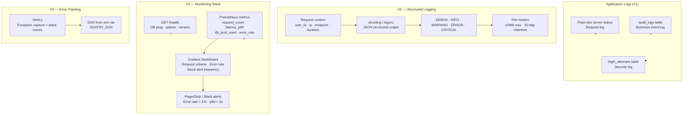

### Audit Log Schema

```
audit_logs
├── log_id      BIGINT AUTO_INCREMENT
├── user_id     INT (nullable — system actions)
├── username    VARCHAR(150)
├── action      ENUM(CREATE, UPDATE, DELETE, VIEW, LOGIN, LOGOUT,
│               EXPORT, IMPORT, APPROVE, REJECT, INVITE)
├── entity_type VARCHAR(100)  — "product", "sales_order", "user", …
├── entity_id   INT
├── entity_label VARCHAR(255)  — human-readable name
├── old_value   JSON           — before state
├── new_value   JSON           — after state
├── ip_address  VARCHAR(45)
├── user_agent  VARCHAR(500)
└── created_at  DATETIME
```

---

## 14. Backup Strategy

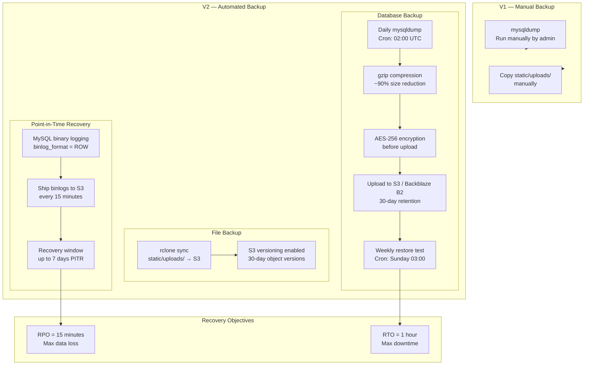

### Backup Runbook (V1 Manual)

```bash
# 1. Dump database
mysqldump -u root -p stockgrid > stockgrid_$(date +%Y%m%d).sql
gzip stockgrid_$(date +%Y%m%d).sql

# 2. Backup uploaded files
tar -czf uploads_$(date +%Y%m%d).tar.gz static/uploads/

# 3. Store offsite (copy to external drive or cloud storage)
# Files: stockgrid_YYYYMMDD.sql.gz + uploads_YYYYMMDD.tar.gz
```

---

## Summary: V1 → V5 Capability Map

| Capability | V1 (Now) | V2 | V3 | V4 | V5 |
|------------|----------|----|----|----|----|
| Auth | Session + lockout + reset | JWT API tokens | SSO (Google/Azure AD) | MFA (TOTP) | Biometric |
| Storage | Local disk | S3/R2 object store | CDN delivery | Multi-region | Edge caching |
| Notifications | SMTP sync | Async queue | Push notifications | Webhooks | Real-time WS |
| AI | Rule-based forecast | Prophet/ARIMA | Claude API NL queries | RL replenishment | Autonomous PO |
| Queue | In-process sync | Celery + Redis | Priority queues | Dead letter queue | Stream processing |
| Cache | None | In-memory TTL | Redis cache | Distributed cache | Edge cache |
| Monitoring | stdout + DB | structlog + Sentry | Prometheus + Grafana | APM (Datadog) | Full observability |
| Backup | Manual | Nightly automated | PITR (15min RPO) | Multi-region replication | Active-active HA |
| API | HTML forms only | REST v1 | GraphQL | WebSocket events | Mobile SDK |

---

*StockGrid Architecture Document — maintained in `/ARCHITECTURE.md`*
